<a href="https://kdbor.engineer">
  <picture>
    <source media="(prefers-color-scheme: dark)" srcset="./assets/readme/banner-dark.svg" />
    <source media="(prefers-color-scheme: light)" srcset="./assets/readme/banner-light.svg" />
    
  </picture>
</a>

<p align="center">
  <a href="https://kdbor.engineer"></a>
  <a href="https://cal.com/sirbor843/meeting"></a>
  <a href="https://www.linkedin.com/in/sirbor843/"></a>
  <a href="https://twitter.com/sirbor843"></a>
  <a href="https://www.goodreads.com/sirbor843"></a>
  <a href="mailto:dominicbor44@gmail.com"></a>
</p>

---

### About

<picture>
  <source media="(prefers-color-scheme: dark)" srcset="./assets/readme/whoami-dark.svg" />
  <source media="(prefers-color-scheme: light)" srcset="./assets/readme/whoami-light.svg" />
  
</picture>

I build data and ML systems that stay **fast**, **reliable**, and **cheap to run**: real-time payment layers, event pipelines, and production models across **fintech, gaming, and healthcare**. I work best close to the people using the system, turning messy requirements and real-world edge cases into features that hold up in production.

### GitHub at a glance

<p align="center">
  <picture>
    <source media="(prefers-color-scheme: dark)" srcset="https://raw.githubusercontent.com/sirbor843/Sirbor843/output/overview-dark.svg" />
    <source media="(prefers-color-scheme: light)" srcset="https://raw.githubusercontent.com/sirbor843/Sirbor843/output/overview-light.svg" />
    
  </picture>
  <picture>
    <source media="(prefers-color-scheme: dark)" srcset="https://raw.githubusercontent.com/sirbor843/Sirbor843/output/languages-dark.svg" />
    <source media="(prefers-color-scheme: light)" srcset="https://raw.githubusercontent.com/sirbor843/Sirbor843/output/languages-light.svg" />
    
  </picture>
</p>

<picture>
  <source media="(prefers-color-scheme: dark)" srcset="https://raw.githubusercontent.com/sirbor843/Sirbor843/output/activity-dark.svg" />
  <source media="(prefers-color-scheme: light)" srcset="https://raw.githubusercontent.com/sirbor843/Sirbor843/output/activity-light.svg" />
  
</picture>

### Build log

<picture>
  <source media="(prefers-color-scheme: dark)" srcset="https://raw.githubusercontent.com/sirbor843/Sirbor843/output/build-log-dark.svg" />
  <source media="(prefers-color-scheme: light)" srcset="https://raw.githubusercontent.com/sirbor843/Sirbor843/output/build-log-light.svg" />
  
</picture>

### Featured work

<p align="center">
  <a href="https://github.com/sirbor843/Commandline_Calculator"><picture>
    <source media="(prefers-color-scheme: dark)" srcset="https://raw.githubusercontent.com/sirbor843/Sirbor843/output/project-commandline_calculator-dark.svg" />
    <source media="(prefers-color-scheme: light)" srcset="https://raw.githubusercontent.com/sirbor843/Sirbor843/output/project-commandline_calculator-light.svg" />
    
  </picture></a>
  <a href="https://github.com/sirbor843/astraLauncher"><picture>
    <source media="(prefers-color-scheme: dark)" srcset="https://raw.githubusercontent.com/sirbor843/Sirbor843/output/project-astralauncher-dark.svg" />
    <source media="(prefers-color-scheme: light)" srcset="https://raw.githubusercontent.com/sirbor843/Sirbor843/output/project-astralauncher-light.svg" />
    
  </picture></a>
  <a href="https://github.com/sirbor843/Jikoni"><picture>
    <source media="(prefers-color-scheme: dark)" srcset="https://raw.githubusercontent.com/sirbor843/Sirbor843/output/project-jikoni-dark.svg" />
    <source media="(prefers-color-scheme: light)" srcset="https://raw.githubusercontent.com/sirbor843/Sirbor843/output/project-jikoni-light.svg" />
    
  </picture></a>
  <a href="https://github.com/sirbor843/FlightsAnalysis"><picture>
    <source media="(prefers-color-scheme: dark)" srcset="https://raw.githubusercontent.com/sirbor843/Sirbor843/output/project-flightsanalysis-dark.svg" />
    <source media="(prefers-color-scheme: light)" srcset="https://raw.githubusercontent.com/sirbor843/Sirbor843/output/project-flightsanalysis-light.svg" />
    
  </picture></a>
  <a href="https://github.com/sirbor843/simple_shell"><picture>
    <source media="(prefers-color-scheme: dark)" srcset="https://raw.githubusercontent.com/sirbor843/Sirbor843/output/project-simple_shell-dark.svg" />
    <source media="(prefers-color-scheme: light)" srcset="https://raw.githubusercontent.com/sirbor843/Sirbor843/output/project-simple_shell-light.svg" />
    
  </picture></a>
  <a href="https://github.com/sirbor843/Kibeti"><picture>
    <source media="(prefers-color-scheme: dark)" srcset="https://raw.githubusercontent.com/sirbor843/Sirbor843/output/project-kibeti-dark.svg" />
    <source media="(prefers-color-scheme: light)" srcset="https://raw.githubusercontent.com/sirbor843/Sirbor843/output/project-kibeti-light.svg" />
    
  </picture></a>
</p>

<p align="center"><a href="https://kdbor.engineer/#work">More projects, architecture walkthroughs, and a skills explorer on the portfolio →</a></p>

### Toolbox

<p align="center">
  <br />
  <br />
  
</p>

<p align="center">
  
  
  
  
  
  
  
</p>

### Experience

<details open>
<summary><b>Data Engineer · Labs Afrika</b> &nbsp;<sub>Fintech · Payments · Mar 2025 to present</sub></summary>

- Integrated **Stripe and M-Pesa** into a high-availability Go payment layer, working directly with merchants on edge cases and transaction flows
- Cut validation and serving latency by **over 50%** with Redis caching, load distribution, and targeted service profiling
- Built real-time customer behavior pipelines in Python and **Kafka** to surface billing anomalies and churn risk early
- Reduced cloud spend by **over 35%** by moving batch workloads to containerized AWS Lambda and Docker
- Designed PostgreSQL audit trails and validation checks, **halving reconciliation discrepancies**

</details>

<details>
<summary><b>Data Engineer · Rapid Research</b> &nbsp;<sub>Gaming · Casino · Nov 2023 to Feb 2025</sub></summary>

- Built high-throughput ETL with **AWS Glue and PySpark**, turning millions of daily gaming events into feature sets for model evals
- Shipped real-time **churn and LTV models** with Python, FastAPI, and Docker
- Automated workflow validation and alerting in **Airflow**, catching silent regressions in minutes rather than hours

</details>

<details>
<summary><b>Junior Data Engineer · TechFlow Solutions</b> &nbsp;<sub>Health Systems · Jan 2022 to Oct 2023</sub></summary>

- Automated healthcare data reconciliation in Python, saving dozens of engineering hours weekly
- Migrated hundreds of gigabytes of clinical data to **AWS S3** with strict schema validation
- Built SQL pipelines across **Redshift and Snowflake** for operational datasets and dashboards

</details>

<details>
<summary><b>Education & community</b></summary>

- **KCA University**, BSc Information Technology
- **ALX Software Engineering**, backend systems: C, Unix internals, distributed backends, DevOps
- **GitHub Campus Expert**, led workshops on Git, open source, and CI/CD with GitHub Actions

</details>

### Writing

- [Cutting serving latency by 50% with Redis caching and Go service profiling](https://kdbor.engineer)
- [Building resilient PySpark and AWS Glue pipelines for millions of daily events](https://kdbor.engineer)
- [Automating workflow validation and alerting in Apache Airflow](https://kdbor.engineer)
- [Writing a Unix shell from scratch in C](https://github.com/sirbor843/simple_shell)

<br />

<a href="https://cal.com/sirbor843/meeting">
  <picture>
    <source media="(prefers-color-scheme: dark)" srcset="./assets/readme/cta-dark.svg" />
    <source media="(prefers-color-scheme: light)" srcset="./assets/readme/cta-light.svg" />
    
  </picture>
</a>

---

<details>
<summary><b>About this repo</b>: source for kdbor.engineer and this profile</summary>

<br />

This repo hosts my portfolio site (plain HTML, CSS and JavaScript, no build step) and this profile README.

```bash
python3 -m http.server 8000   # then open http://localhost:8000
```

| Path | What's there |
|---|---|
| `index.html` | Page structure and static copy |
| `assets/js/data.js` | **All editable content**: projects, experience, skills, writing, architectures |
| `assets/js/script.js` | Interactivity: command palette (⌘K), terminal, Cal.com booker, skills explorer, live GitHub stats |
| `assets/css/style.css` | Design tokens, themes and accents, print-to-résumé styles |
| `scripts/readme/generate.mjs` | Renders this README's cards (dark and light) from live GitHub data |
| `.github/workflows/readme-cards.yml` | Regenerates the cards daily and publishes them to the `output` branch |

**Scheduler.** The booking calendar talks to Cal.com's public API straight from the browser (no API key or server needed for a public event type). If the API can't be reached, the official Cal.com embed loads instead.

</details>

<p align="center"><sub>Cards regenerate daily from live GitHub data · designed to match <a href="https://kdbor.engineer">kdbor.engineer</a></sub></p>
